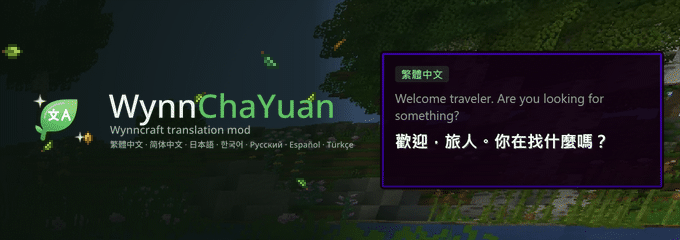

<p align="center">
  
</p>

# WynnChaYuan

繁體中文：**[README.md](README.md)**

WynnChaYuan is an open-source, non-profit project that translates Wynncraft into other languages (a
client-side Fabric 1.21.11 mod). It puts the English in the game into your language, and **whether the
original stays is up to you**: the translation can sit in a panel beside it, or be written in its place.

**It will always be free. There will never be a "pay to get the full translation or features" tier.**

[Download](https://github.com/LyuChaCha/WynnChaYuan/releases/latest) ·
[Website](https://wynnchayuan.com/) ·
[Features](https://wynnchayuan.com/features) ·
[Capes](https://wynnchayuan.com/capes) ·
[Translate](https://wynnchayuan.com/translate) ·
[Feedback](https://wynnchayuan.com/feedback) ·
[Changelog](CHANGELOG.md) ·
[Report a problem](https://github.com/LyuChaCha/WynnChaYuan/issues) ·
[CurseForge](https://www.curseforge.com/minecraft/mc-mods/wynnchayuan) ·
[Modrinth](https://modrinth.com/mod/wynnchayuan) ·
[Ko-fi](https://ko-fi.com/lyuchacha)

> [!IMPORTANT]
> **About the translations.** Some of the translations are written by hand and then rendered by AI,
> a smaller part is translated by AI directly, and most of the core content has been
> proofread by a person. The other languages are currently AI-translated from the
> Traditional Chinese, so expect mistranslations and inconsistent terms.
> Report problems to **LyuChaCha** on Discord or on
> [GitHub Issues](https://github.com/LyuChaCha/WynnChaYuan/issues).

## Features

### How translations are shown

- **Pick how each one is shown**: item tooltips, quest dialogue, dialogue choices, nameplates and floating text, chat messages and more can each be set to **off**, **replace in place** (written where the original was) or **separate panel** (shown beside it, the original untouched).
- **Written into Wynncraft's own dialogue box**: quest dialogue and choices can go straight into the original box, keeping its frame, the name and the portrait, typed out in step with the original; or into a separate box.
- **Put the panels where you like**: every box can be dragged; dialogue, choices and the quest tracker can also be resized from the corner.
- **Fallback language**: lines your language has not translated yet can show another language instead, or stay in the original.
- **Translated names or not**: names of quests, caves, discoveries and other content can be shown translated, translated with the original, or in the original. Gear names stay in English by default (they are proper nouns, and the trade market and the wiki use the English ones); you can turn them on in the settings, and hold Shift to peek at the other name.
- **Translations update themselves**: once new translations are merged on GitHub you get them **without a mod update**. They are downloaded on your first launch; after that, every launch checks for new ones and, if there are any, chat shows a line where "Click here to update" applies them right away. Turn on "Auto-update translations" under Settings → Data to have them downloaded on launch without asking. Offline, the last downloaded copy (or the one in the jar) is used.

### What it translates

| Content | What is translated, and how it is shown |
|---|---|
| Item tooltips | Gear lore, stats, Major IDs; a panel beside the tooltip, or written into the tooltip itself |
| Ability trees | Nodes, descriptions and archetypes for all five classes |
| Quest dialogue, dialogue choices | Written into **Wynncraft's own dialogue box** (frame, nameplate and portrait kept), or a separate box |
| Quest tracker | Its own box; the heading says what is tracked (quest, world event, cave, raid…) |
| NPC nameplates, floating text | A box while you look at one, or replaced in place; crafting stations and interaction prompts included |
| Chat messages | Server messages (quest completions, rewards, area transitions); column layouts such as the Lootrun summary and beacons stay aligned. Player chat is never translated |
| Scoreboard | The column on the right: raid objectives, Lootruns, party and guild wars |
| Menus and interfaces | Trade market, guild, store and other screens |
| Lootruns, raids, dungeons | Missions, boons, beacons, aspects, gambits, end-of-run and loot panels, dungeon names and keys |
| Discoveries, secret discoveries | Names, descriptions and stories |
| Title text | The big title and subtitle in the middle of the screen |

### Market search

Type **in your own language** in the trade market's search box: the mod sends the English name for you,
and lists matches as you type (↑↓ to pick, Tab to fill).

### Support for other mods

- **[WynnMarketSearch](https://modrinth.com/mod/wynnmarketsearch)**: its search box takes translated names, and results show the translation next to the English name.
- **[Wynnventory](https://modrinth.com/mod/wynnventory)**: its price box, reward screen and settings are translated; hold Shift to see the original.

The full list is under [Mod compatibility](#mod-compatibility) below.

### Tools that come with it

- **Copy chat**: lists recent chat messages; click one to copy it, so a report can include the English text (key unbound by default).
- **Panel screenshot**: copies the translation panel to the clipboard or saves it as an image (key unbound by default).
- **In-game update**: when a new version is out, chat says so once; click "click here to update" in that message (same as typing `/wcy update`), or press Update on the release notes screen, and the new version is downloaded from GitHub Releases and swapped in when you close the game. Nothing is downloaded unless you press it.
- **Capes and leaves**: wear your own cape, with a leaf before your name; see [Capes, the grey leaf, and what the mod sends](#capes-the-grey-leaf-and-what-the-mod-sends).

**Client-side only.** The server does not need it.

### Settings

Three ways to open them:

- type `/wcy` (or `/wynnchayuan`) in chat
- [Mod Menu](https://modrinth.com/mod/modmenu)'s mod list → WynnChaYuan → configure
- bind a key under Controls → WynnChaYuan (**nothing is bound by default**, so the mod takes none of your keys)

| Tab | What's in it |
|---|---|
| Items | Item translation (separate panel / replace in place / off), translate item names, market search, panel screenshot, mod support |
| Panel | Follow the mouse or pin it, which side, gap, arrange the boxes; the theme colour (of the settings screen) and the border colour (of the boxes in game) are set separately |
| Dialogue | Quest dialogue, dialogue choices (separate box / replace in place / off), hold time, dialogue/tracker boxes |
| World & chat | Nameplates and floating text (with range and aim angle), chat messages, scoreboard, title text, copy chat |
| Data | Translation language, fallback language, interface language, translation source, auto-update translations, update translations, translation version, collect untranslated strings, collect GUI text, export untranslated strings, how to submit, debug dumps |

Hover a setting for an explanation; search the settings from the top left, and the preview on the right follows the values you change.

## Capes, the grey leaf, and what the mod sends

- **Capes**: wear your own WynnChaYuan cape, visible to other players who have this mod. Upload a high-resolution cape at <https://wynnchayuan.com> (F6 > Badge & cape > Cape gallery opens it signed in), or pick one you like in the [cape gallery](https://wynnchayuan.com/capes) and wear it directly; you can switch back to your own at any time. Anyone can upload a PNG (up to 1 MB); GIFs and the 20 MB limit are for developers, sponsors and contributors. Draw it on a template from [`capes/templates`](https://github.com/LyuChaCha/WynnChaYuan/tree/main/capes/templates), up to 1056×816. A cape nobody has worn for more than 7 days is removed.
- **Leaves**: every player who has this mod gets a leaf before their name (grey if you have no role), visible to each other. A developer's rainbow mode and the roles you chose to show look the same to others as they do to you.
- **These two features talk to our server (wynnchayuan.com).** The mod checks in once when you join Wynncraft and sends: your Minecraft UUID, your Mojang-signed public profile (name and skin), a public key and signature that prove the account is yours, whether to show your cape, and your badge settings (rainbow leaf, which roles to show). Uploading a cape also sends the image you chose. **Your private key and login credentials never leave the game; the mod does not send your world, chat or any game content, and the server does not store IP addresses.** The public list holds hashed codes only, not UUIDs or names.
- **There is no switch for this**: the mod checks in whenever it is installed and you join Wynncraft, so every user has a leaf. If you do not want others to see your cape, turn off "Wear my cape" under F6 > Badge & cape.
- **Site account** (optional): register at wynnchayuan.com with Discord, then type `/wcy link <code>` in game to link your game ID. We only read your Discord account ID and display name.
- **Update button**: only when you press Update (or type `/wcy update`) does the mod download the new version from GitHub Releases, and it is swapped in when you close the game.

The full details are in the site's [privacy policy](https://wynnchayuan.com/privacy).

## Languages and progress

| Language | Coverage |
|---|---|
| `zh_tw` Traditional Chinese | Main language, everything |
| `zh_cn` Simplified Chinese | Everything, quest dialogue included |
| `ja_jp` Japanese | Everything, quest dialogue included |
| `ko_kr` Korean | Everything, quest dialogue included |
| `ru_ru` Russian | Everything, quest dialogue included |
| `es_es` Spanish | Everything, quest dialogue included |
| `tr_tr` Turkish | Everything, quest dialogue included |

Switch under **Settings → Data**, without changing the game's language or restarting:

- **Translation language**: which translations to show
- **Fallback language**: what to show where that language has nothing yet (another language, or the original)
- **Interface language**: the language of the settings screens themselves (English included)

### How far it has got

Traditional Chinese leads for now; the other languages are filled in after it.

- **Done**: most of the text in the official records, the CDN and Wynntils has been translated, including item tooltips, ability trees, quest dialogue and choices, the quest tracker, NPC nameplates, system chat messages, interfaces such as the market and guild, Lootruns / raids / dungeons, and the big title text in the middle of the screen.
- **Not done yet**: Secret-related content, dialogue of NPCs outside quests, text nobody has found yet, lines whose original records are themselves wrong, and the content of the latest game update. These are being filled in, and **a report when you run into one speeds it up a lot** (see [How to help](#how-to-help)).

<!-- 進度:開始 -->
更新於 2026-10-19 / Updated 2026-10-19

**翻了哪些**：任務對話與任務書、物品（名稱、詞條、敘述、Major ID）、技能樹、介面（設定畫面、背包、交易市場、公會、地圖、追蹤欄）、NPC 與地區名稱、看板與聊天公告。

**大概翻到哪**：7 種語言目前都在 **95% 以上**，繁體中文最完整。剩下的多半是零星的名稱與半句話，而且遊戲還在更新——**一定還有漏的**。看到沒翻、翻錯或版面跑掉的，[開個 issue](https://github.com/LyuChaCha/WynnChaYuan/issues) 告訴我們就好。

**What's covered**: quest dialogue and the quest book, items (names, stats, lore, Major IDs), the ability tree, the interface (settings, inventory, trade market, guild, map, tracker), NPC and place names, signs and chat announcements.

**Roughly how far**: every language is past **95%**, Traditional Chinese being the most complete. What is left is mostly stray names and half-sentences, and the game keeps changing — **there will be gaps**. Found something untranslated, wrong, or laid out badly? [Open an issue](https://github.com/LyuChaCha/WynnChaYuan/issues).

每一種語言還缺哪些檔案 / Per-language breakdown: [PROGRESS.md](docs/PROGRESS.md)
<!-- 進度:結束 -->

## Install

| Requirement | Version |
|---|---|
| Minecraft | 1.21.11 |
| Loader | Fabric |
| Dependencies | [Wynntils](https://modrinth.com/mod/wynntils) 4.2+, [Fabric API](https://modrinth.com/mod/fabric-api) |

1. Download the jar: [GitHub Releases](https://github.com/LyuChaCha/WynnChaYuan/releases/latest) ·
   [Modrinth](https://modrinth.com/mod/wynnchayuan) ·
   [CurseForge](https://www.curseforge.com/minecraft/mc-mods/wynnchayuan)
2. Put it in `mods/`. In game, type `/wcy` in chat or open the settings from Mod Menu.

When a new version comes out, the game tells you and the Update button swaps it in; translations do not wait for a new version, see "Translations update themselves" above.

### Mod compatibility

| Mod | Status | Notes |
|---|---|---|
| [Wynntils](https://modrinth.com/mod/wynntils) 4.2+ | **Required** | Item, quest and chat data all come through it; its own screens (content book, map, quest and cave names) are translated too |
| [Fabric API](https://modrinth.com/mod/fabric-api) | **Required** | |
| [Mod Menu](https://modrinth.com/mod/modmenu) | Optional, supported | Adds a configure button to the mod list |
| [WynnMarketSearch](https://modrinth.com/mod/wynnmarketsearch) | Optional, supported | Its search panel finds items by translated name and shows the translation next to the English name; what gets sent is still the English name |
| [Wynnventory](https://modrinth.com/mod/wynnventory) | Optional, supported | Its price box, reward screen and settings screen are translated too (item names follow the "Translate item names" setting); hold Shift to see the original. The switch only appears in the settings when it is installed |
| [WynnMod](https://modrinth.com/mod/wynnmod) | Compatible | The gear tooltips it redraws are translated too (can be turned off under Settings → Items → Mod support). The lines it reads to decide a raid's outcome stay in English while it is installed, so streaks are counted correctly (without it you see the translation as usual) |
| Mods that add sections to tooltips (Nori, Wynnpool…) | Compatible | Those sections are kept as they are. If they make the translation panel longer than the original, list their labels in `config/wynnchayuan/third-party-sections.json` to filter them |

Mods not listed here usually work alongside as well: this mod only changes the text drawn on your client. If something clashes, [open an issue](https://github.com/LyuChaCha/WynnChaYuan/issues) with your mod list.

## A line switches back to English halfway?

**That is normal.** It means the sentence is not in the corpus yet, so the mod shows the original.

Tell us as described in [How to help](#how-to-help). Once it is added, everyone gets it on their next
launch; no mod update needed.

## How to help

Text that reads oddly, terms you want made consistent, features you would like: all welcome.
**You do not have to translate or program anything**:

- **Report with a screenshot**: a screenshot of anything still in English, mistranslated or laid out badly already helps a lot. Copy chat copies a chat line's original text, and Panel screenshot saves the translation panel as an image.
- **Export untranslated strings**: quest dialogue and NPC nameplates have no official data source; they only arrive when players run into them.
  1. **Settings → Data → Export untranslated strings** opens `config/wynnchayuan/export`, which holds `captured.json`.
  2. Look through the file and delete anything personal (other players' names, guild names, private chat).
  3. **Settings → Data → How to submit** opens the [issue form](https://github.com/LyuChaCha/WynnChaYuan/issues/new?template=corpus.yml); drag the file in. Or send it to **LyuChaCha** on Discord.
- **[Translate together](https://wynnchayuan.com/translate)**: search for a line you saw in game, or list only what is untranslated. Translators of each language suggest better translations and vote on disputed terms there; once a moderator decides, it goes into the translations (translators are assigned by a moderator; to join, contact **LyuChaCha** on Discord).
- **[Feedback](https://wynnchayuan.com/feedback)**: sign in with Discord to send translation, content, website or feature suggestions; or use the bot's `/feedback` on Discord. A translation suggestion opens a public GitHub issue automatically, showing your Discord display name.
- **[GitHub Issues](https://github.com/LyuChaCha/WynnChaYuan/issues)**: wrong translations, wrong terms, crashes or broken screens; the English text, a log and a screenshot help most.
- **Pull requests**: change translations or code directly; see [Helping translate](#helping-translate) below.
- **Discord**: contact **LyuChaCha**.

The mod **never sends game text by itself**. (What the mod does send for capes and leaves is listed under "Capes, the grey leaf, and what the mod sends" above.) The export already leaves out player names and guild,
party, shout and private chat, but the filter is heuristic, so check it before you send it.

## Helping translate

No programming needed: translations are JSON, and you fill in `dst` on the GitHub website and open a pull request. Translators of each language can also suggest and vote on the [Translate together](https://wynnchayuan.com/translate) page, without touching GitHub.

- [CONTRIBUTING.en.md](CONTRIBUTING.en.md): workflow, placeholders, colour tags
- [GLOSSARY.md](GLOSSARY.md): term glossary (Traditional Chinese)
- [For translators](docs/for-translators.md): recent conventions and changes (Traditional Chinese)

To try your own translations in game: set Settings → Translation source to **Local**, then press "Re-read local files" on the Update translations row after editing.

## Website and Discord bot

[wynnchayuan.com](https://wynnchayuan.com/) is available in eight languages:

| Page | What's there |
|---|---|
| [Home](https://wynnchayuan.com/) | Download, install instructions, the team and sponsoring |
| [Features](https://wynnchayuan.com/features) | What gets translated and the tools that come with it, with a live preview |
| [Capes](https://wynnchayuan.com/capes) | The cape gallery: browse everyone's capes, add favourites, wear one directly |
| [Account](https://wynnchayuan.com/account) | Register with Discord, link your game ID, upload a cape |
| [Translate](https://wynnchayuan.com/translate) | Search the translations, suggest, vote on terms |
| [Feedback](https://wynnchayuan.com/feedback) | Feedback and suggestions |

**Discord bot** (in servers the bot has been added to):

| Command | What it does |
|---|---|
| `/status` | Site status: players, capes, pending reviews, collaborative translation |
| `/cape` | Show a player's current WynnChaYuan cape |
| `/translate` | Search the translations, by English source or translation |
| `/feedback` | Send feedback or a suggestion to the team; it goes to the same place as the website's feedback page |

## Building from source

```bash
gradle build
```

Requires JDK 21. Wynntils has no Maven coordinates: download the **Fabric** jar from
[Modrinth](https://modrinth.com/mod/wynntils/versions) into `libs/` first (the build stops and tells
you if it is missing). Corpus checks: `python tools/validate.py`.

## Sponsoring

**The translations are free, and will stay free.** Every translation and every translation feature is provided by the team at no cost, and there will never be a "pay to get the full translation or features" tier.

Sponsoring is entirely voluntary:

- **Not sponsoring never lowers translation quality.** Everyone gets the same translations, updates and fixes - no fewer and no later.
- **Sponsors only get fun extras**: the cyan leaf before your name, a place on the list, and cosmetic features such as GIF capes and the 20 MB cape limit.
- **Sponsors' feedback is given priority**: we look at and act on their reports and suggestions first.

To buy us a tea: **<https://ko-fi.com/lyuchacha>**

A one-off **20 USD** or **2 USD/month** or more puts you on the sponsor list: below, under
Settings → About / Credits, and as a cyan leaf before your name.

## Roles and badges

The colour of the leaf before your name depends on your role on the credits list. That list is the
"Translation team" section below; a maintainer adds you once it is confirmed, and needs your Minecraft ID.

| Role | Leaf | How to get it |
|---|---|---|
| Developer | Gold | Helps develop and maintain the code |
| Sponsor | Cyan | A one-off **20 USD** or **2 USD/month** or more ([Ko-fi](https://ko-fi.com/lyuchacha)) |
| Contributor | Green | Any one of the items below |
| Everyone else running the mod | Grey | — (comes with the mod; other players with the mod see it) |

**What counts for contributors** — whether it was used, not how much:

- **Translations for your own language**: filling in missing lines, or a `captured.json` you sent that was used to fill gaps, merged into main.
- **Correct fixes**: pointing out a mistranslation, a missing line or inconsistent wording that is confirmed and fixed.
- **Real help with the code**: a merged fix or feature, or a report that reproduces a problem and helps find the cause.

People on the list can change their leaf colour under Settings → Badge; with several roles you can pick
which leaves to show, at least one.

## Translation team

The same list is in game under **Settings → About / Credits**. To add someone, edit
[`credits.json`](src/main/resources/assets/wynnchayuan/credits.json).

Thanks to the Traditional and Simplified Chinese communities for all their help along the way.

<!-- credits:begin -->

<!-- Generated by tools/sync-credits.py from credits.json - do not edit by hand. -->

### Developers

| Name | Minecraft ID |
|---|---|
| LyuChaCha | `Green_teaTW` |

### Sponsors

| Name | Minecraft ID |
|---|---|
| ㄉ綠 | `MlyuL` |
| 蛇蛇 | `snakiesnake` |

### Contributors

| Name | Minecraft ID |
|---|---|
| suSCP | `SCP_Night_sky` |
| 隨意 | `brine7459` |
| Chicken_sky | `Chicken_sky` |
| Pure | `21_Pure` |
| 泥巴先生 | `MrMud8033112` |
| 幻影Joker | `NOT_Joker` |
| Pootato | `Pootato__` |
| N02sAyLa | `eric18960` |
| 鳥鳥 | `Smellybird_` |
| 98 | `Jackandmina98` |
| Jimmy | `0110jimmy` |
| 雪花 | `ThEsnowF` |
| Roy | `aaroye` |
| Chq | `Chqrish` |
| 邊緣安德 | `Enderchen2580` |
| AdoreFuSei | `AdoreFuSei` |
| anilken | `Pandik` |
| yool | `yool141` |
| 早安白月 | `ZLGX` |
| 百里莫凌 | `BaiLiML` |

### Data sources

| Name | Minecraft ID |
|---|---|
| Wynntils (item / ability CDN) | — |
| Wynncraft | — |

Translate one line and you are on this list. See [CONTRIBUTING.en.md](CONTRIBUTING.en.md).

<!-- credits:end -->

## Links

- Website: <https://wynnchayuan.com/>
- Features: <https://wynnchayuan.com/features>
- Cape gallery: <https://wynnchayuan.com/capes>
- Translate together: <https://wynnchayuan.com/translate>
- Feedback: <https://wynnchayuan.com/feedback>
- GitHub: <https://github.com/LyuChaCha/WynnChaYuan>
- CurseForge: <https://www.curseforge.com/minecraft/mc-mods/wynnchayuan>
- Modrinth: <https://modrinth.com/mod/wynnchayuan>
- Ko-fi (optional sponsoring; the translations are always free): <https://ko-fi.com/lyuchacha>
- Discord: **LyuChaCha**

## Sources and licences

- Item and ability data: the public CDN used by [Wynntils](https://github.com/Wynntils/Wynntils)
- Quest and secret discovery lists: [Wynncraft Wiki](https://wynncraft.wiki.gg/) (CC BY-SA)
- CJK and Cyrillic glyphs in the dialogue box: [Fusion Pixel 10px](https://github.com/TakWolf/fusion-pixel-font) (SIL OFL 1.1,
  full text in `src/main/resources/assets/wynnchayuan/font/ofl-fusion.txt`). A line containing a glyph the font
  lacks stays in English instead of drawing boxes
- Resource-pack glyphs and layout belong to Wynncraft; this mod only displays them
- Code: [GNU AGPLv3 or later](LICENSE)
- Translations and data (the corpus under `src/main/resources/assets/wynnchayuan/translations/`, `GLOSSARY.md`, etc.): [CC BY-NC-SA 4.0](LICENSE-DATA).
  Content taken from the Wynncraft Wiki stays under its original CC BY-SA

**Not affiliated with Wynncraft or the Wynntils team.** A community translation project.
