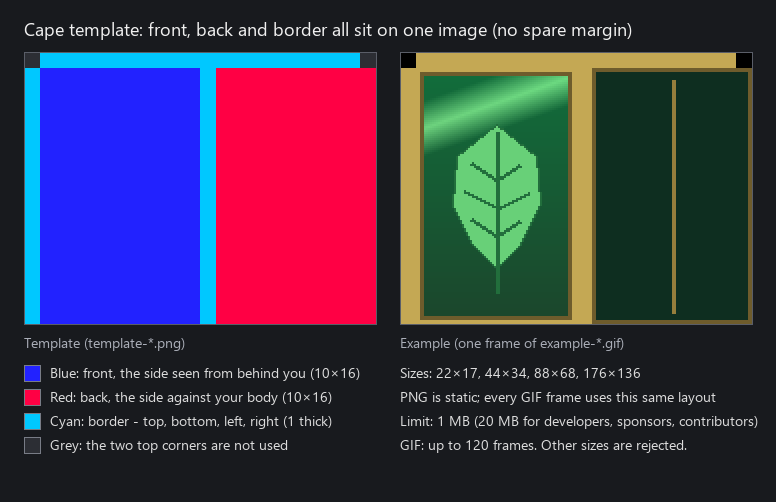
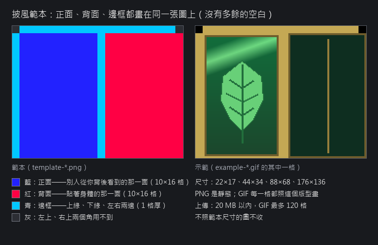

# Cape templates / 披風範本

[English](#english) · [中文](#中文)

## English

Draw your cape on one of the templates, then upload it in game (**F6 → Badge & cape**) or at <https://wynnchayuan.com>.

| File | What it is |
| --- | --- |
| `template-22x17.png`, `template-44x34.png`, `template-88x68.png`, `template-176x136.png` | The layout in four sizes. Pick one and paint over it. |
| `example-88x68.png` | A finished static cape. |
| `example-*.gif` | A finished animated cape in each size. |
| `guide.en.png`, `guide.png` | The picture above, in English and Chinese. |

- **Blue** is the front, the side others see from behind you (10×16 cells). **Red** is the back, the side against your body (10×16 cells). **Cyan** is the border: top, bottom, left and right, 1 cell thick. The two top corners are not used.
- The image must be exactly one of the four sizes: 22×17, 44×34, 88×68 or 176×136.
- PNG is static and open to everyone, up to 1 MB. GIF (up to 120 frames, every frame on this same layout) and the 20 MB limit are for developers, sponsors and contributors.
- Political, obscene, unlawful or racist content is not allowed and will be removed.

## 中文

照範本畫好之後，在遊戲裡上傳（**F6 → 徽章與披風**），或到 <https://wynnchayuan.com> 上傳。

| 檔案 | 用途 |
| --- | --- |
| `template-22x17.png`、`template-44x34.png`、`template-88x68.png`、`template-176x136.png` | 四種尺寸的版型，挑一個直接畫上去。 |
| `example-88x68.png` | 畫好的靜態披風。 |
| `example-*.gif` | 各尺寸畫好的動態披風。 |
| `guide.png`、`guide.en.png` | 上面那張說明圖的中文版與英文版。 |

- **藍色**是正面，別人從你背後看到的那一面（10×16 格）；**紅色**是背面，貼著身體的那一面（10×16 格）；**青色**是邊框：上緣、下緣、左右兩邊，1 格厚。左上、右上兩個角用不到。
- 圖片必須剛好是四種尺寸之一：22×17、44×34、88×68、176×136。
- PNG 是靜態，大家都能傳，1 MB 以內。GIF（最多 120 格，每一格都照這個版型畫）與 20 MB 的上限給開發者、贊助者、貢獻者。
- 不可以上傳政治、不雅、違反法規、種族歧視的內容，違規的會被移除。
